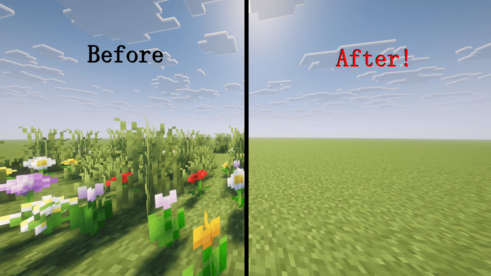

This mod removes both grass and flower generation in Minecraft, combining my [Remove Grass](https://github.com/LiterallyUs/removegrass/releases/tag/1.0.0) and [Remove Flowers](https://github.com/LiterallyUs/removeflowers/releases/tag/1.0.0) mods into one.

Requires Fabric API.

Bone meal still works.

This mod removes the generation of the following: short grass, tall grass, fern, large fern, short dry grass, tall dry grass, dead bush, grass, bush, firefly bush, leaf litter, crimson roots, warped roots, nether sprouts, red shrub, seagrass, tall seagrass, kelp, kelp plant, dandelion, poppy, blue orchid, allium, azure bluet, red tulip, orange tulip, white tulip, pink tulip, oxeye daisy, cornflower, lily of the valley, sunflower, lilac, rose bush, peony, pink petals, wildflowers, closed eyeblossom, open eyeblossom, wither rose, torchflower, pitcher plant, golden dandelion.

Note: If you use Remove Grass & Flowers, you don’t need the separate Remove Grass or Remove Flowers mods. 

My other mod that removes only grass: [Remove Grass](https://github.com/LiterallyUs/removegrass/releases/tag/1.0.0)

My other mod that removes only flowers: [Remove Flowers](https://github.com/LiterallyUs/removeflowers/releases/tag/1.0.0)
